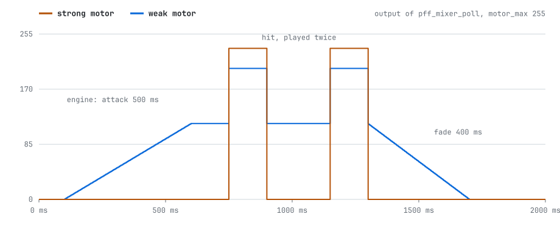

<h1 align="center">padff</h1>

<p align="center"><em>The rumble effects a game uploads, turned into the motor intensities a gamepad accepts.</em></p>

<p align="center">
  <a href="https://github.com/augustoflorentino/padff/releases/latest"></a>
  <a href="LICENSE"></a>
  
</p>

<p align="center">
  <picture>
    <source media="(prefers-color-scheme: dark)" srcset="docs/images/mix-dark.svg">
    
  </picture>
</p>

A game never sets motor speeds. It uploads effects (rumble, periodic, ramp, with delays,
envelopes and repetitions), plays them and changes the gain, and something has to turn that into
two numbers every few milliseconds. On Linux that something is `ff-memless`, inside the kernel
and only for the kernel's own drivers. A program that forwards a virtual pad to hardware the
kernel does not drive (raw HID, Bluetooth, a microcontroller) has to do the same work itself.

padff is that work with `ff-memless` semantics, as a library. It has no clock, allocates
nothing and makes no system calls, so the same code runs on a desktop and on a microcontroller.

## How it behaves

- rumble effects drive the strong and weak motors directly; periodic, constant and ramp effects
  become one intensity on both
- each effect has its start delay, a length or none, a repeat count, and an attack and fade
  envelope
- a global gain, as many slots as the memory block holds, and effects mixed by maximum or by
  clipped sum
- up to four motors: strong, weak and the two trigger motors of Xbox pads, each with its scale
- the output is quantized to the motor scale and reported only when it changes, optionally no
  more often than a minimum interval
- the mixer says how long the caller may sleep before the output can change, so the loop wakes
  only when there is something to send

## Driving the mixer

```c
static unsigned char mem[PFF_MIXER_SIZE(16)];
pff_mixer_t *mixer;
pff_config_t config = {sizeof(config), PFF_MIX_MAX, 255, 0, 2, 0};
uint16_t motors[2];
int send;

pff_mixer_init(mem, sizeof(mem), 16, &config, &mixer);

pff_mixer_upload(mixer, id, &effect, now_ms);
pff_mixer_play(mixer, id, count, now_ms);

pff_mixer_poll(mixer, now_ms, motors, 2, &send);
if (send)
    send_to_gamepad(motors[0], motors[1]);
pff_mixer_next(mixer, now_ms, &wait_ms);
```

Upload and play whenever the game sends a command. In the event loop, poll, send if asked to,
then sleep for at most `wait_ms`; `PFF_NEVER` means until the next command.

[`examples/basic.c`](examples/basic.c) plays a 150 ms hit twice on the strong motor and an
engine with a 100 ms attack on the weak one, on a 0 to 255 scale:

```console
$ ./basic
   0 ms  strong 233  weak   0
  10 ms  strong 233  weak   8
  20 ms  strong 233  weak  16
  ...
 100 ms  strong 233  weak  78
 300 ms  strong   0  weak  78
 400 ms  strong   0  weak   0
```

[`examples/ff_replay.c`](examples/ff_replay.c) replays what a Linux game sends: `EVIOCSFF`,
`EV_FF` play and stop, `FF_GAIN` and `EVIOCRMFF`.

## Getting it

```sh
cmake -S . -B build -DBUILD_SHARED_LIBS=ON
cmake --build build
cmake --install build --prefix /usr/local
```

Then `find_package(padff REQUIRED)` with `padff::padff`, or `pkg-config --cflags --libs padff`.
For firmware and other builds without CMake, `scripts/amalgamate.sh` writes the single header
`dist/padff/padff.h`: define `PFF_IMPLEMENTATION` in one `.c` file before including it, and
`PFF_STATIC` as well to keep the functions private to that file.

## API

[`include/padff/padff.h`](include/padff/padff.h) declares everything.

The mixer lives in the block given to `pff_mixer_init`. `PFF_MIXER_SIZE(slots)` is always
enough, at any alignment, and there is nothing to destroy: drop the block. While the mixer lives,
touch the block only through padff (C aliasing rules), and call `pff_mixer_init` again to reuse
it. `now_ms` comes from any monotonic millisecond counter and may wrap around `UINT32_MAX`; poll
at least once every 24 days. Functions that can fail return `PFF_OK` or `PFF_ERR_ARG` (null
pointer, bad option), `PFF_ERR_SPACE` (block too small), `PFF_ERR_SLOT` (slot out of range, or
play on an empty slot) or `PFF_ERR_EFFECT` (unknown type), named by `pff_strerror`.

`pff_mixer_poll` writes `count` motor values (1 to `PFF_MOTORS`) in the order
`PFF_MOTOR_STRONG`, `PFF_MOTOR_WEAK`, `PFF_MOTOR_LEFT_TRIGGER`, `PFF_MOTOR_RIGHT_TRIGGER`, and
asks to send when one of the motors the config declares changes. While an envelope or ramp is
moving, `pff_mixer_next` returns the time until the scaled output changes, looking at most 64 ms
ahead. `pff_mixer_stop` stops one slot and `pff_mixer_stop_all` every slot, both leaving the
effects uploaded; `pff_mixer_playing` tells whether a slot is still playing, delay included.
`pff_mixer_set_gain` sets the global gain, 65535 by default, as `FF_GAIN` does.

The config, given to `pff_mixer_init` or later to `pff_mixer_configure`, is checked whole
before any field is applied. `NULL`, or a zeroed config with `size` set, gives the defaults.

| `pff_config_t` | meaning | default |
| --- | --- | --- |
| `size` | `sizeof(pff_config_t)`; the 20-byte config of padff 3.0 is also accepted | |
| `mix` | `PFF_MIX_MAX` or `PFF_MIX_SUM` | maximum |
| `motor_max` | motor scale, 1 to 65535 | 65535 |
| `interval_ms` | minimum time between sends, up to `INT32_MAX` | 0 |
| `motors` | motors on the device, 1 to `PFF_MOTORS` | 2 |
| `trigger_max` | scale of the trigger motors | `motor_max` |

| `pff_effect_t` | meaning |
| --- | --- |
| `size` | `sizeof(pff_effect_t)` (28), or 24 for an effect without trigger fields (padff 1.x, vpad 1.x); only `size` bytes are read |
| `type` | `PFF_RUMBLE`, `PFF_PERIODIC`, `PFF_CONSTANT` or `PFF_RAMP` |
| `strong`, `weak` | rumble: motor intensities, 0 to 65535 |
| `level` | periodic magnitude, constant level, ramp start: -32768 to 32767; intensity is `2 * abs(level)` |
| `level_end` | ramp end |
| `delay_ms` | wait before each repetition |
| `length_ms` | length of each repetition; 0 plays until stopped |
| `attack_ms`, `attack_level` | start from `attack_level` (0 to 65535) and reach the effect in `attack_ms` |
| `fade_ms`, `fade_level` | go to `fade_level` in the last `fade_ms`; only for effects with a length |
| `left_trigger`, `right_trigger` | rumble: trigger motor intensities, 0 to 65535 |

### Against ff-memless

`pff_mixer_play(count)` plays `count` repetitions of delay plus length, and 0 stops. Uploading
to a playing slot replaces the effect and restarts the current repetition, keeping the ones
left; uploading to a finished slot does not start it again. Gain scales each effect before
mixing, and the result is rounded to `0..motor_max`. All of that is `ff-memless` behaviour. The
differences:

- the default mix is the maximum; `ff-memless` sums and clips, which is `PFF_MIX_SUM`
- envelopes also apply to rumble effects, which `ff-memless` ignores
- `PFF_RAMP` has no `ff-memless` counterpart

From a Linux `struct ff_effect`, copy `replay.delay` and `replay.length`; rumble takes
`strong_magnitude` and `weak_magnitude`, periodic `magnitude`, constant `level`, ramp
`start_level` and `end_level`. Double the envelope levels, since Linux uses 0 to 32767.

## How it is checked

- `tests/traces/` holds command sequences recorded from SDL3 on a Linux uinput gamepad,
  `SDL_RumbleGamepad` as games call it and the haptic API with envelopes, repetitions and gain,
  each with its expected output
- `tests/oracle.py` is a second, independent model of the mixer; `tests/trace_run.c` replays
  the recordings and random sequences against it, polling every millisecond and sleeping by
  `pff_mixer_next`, at time 0 and right before the 32-bit wrap
- `fuzz/fuzz_commands.c` fuzzes command sequences and checks that nothing is sent before the
  time `pff_mixer_next` promised

`cmake --preset dev && cmake --build build/dev && ctest --preset dev` runs all of it under ASan
and UBSan with `-Werror`; `cmake --preset fuzz` builds the fuzzer. The CI workflow adds MSVC,
install tests on three systems, and symbol and ABI checks.

---

padff 3.6 does everything it set out to do and now only takes fixes. Releases follow Semantic
Versioning, structs passed in carry their size and only grow at the end, and the
[CHANGELOG](CHANGELOG.md) says what each update means for callers. Problems go to the
[issue tracker](https://github.com/augustoflorentino/padff/issues), vulnerabilities to
[SECURITY.md](SECURITY.md). MIT license.
